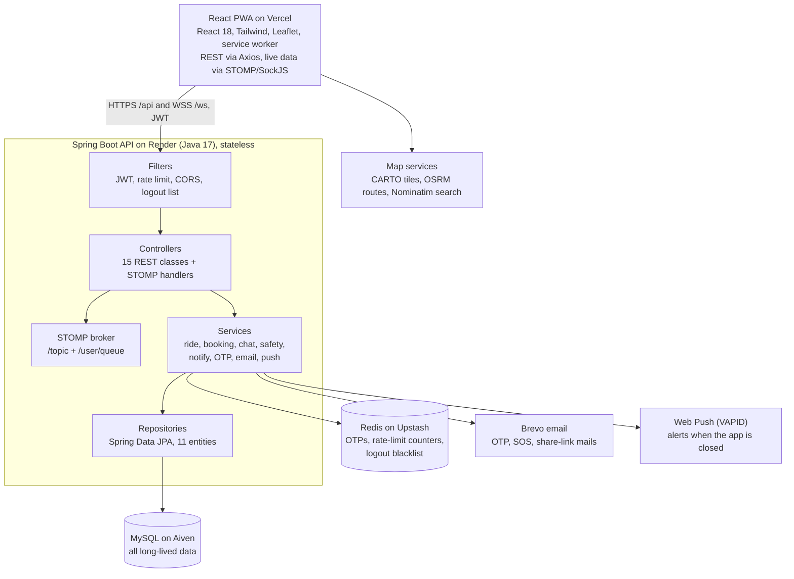
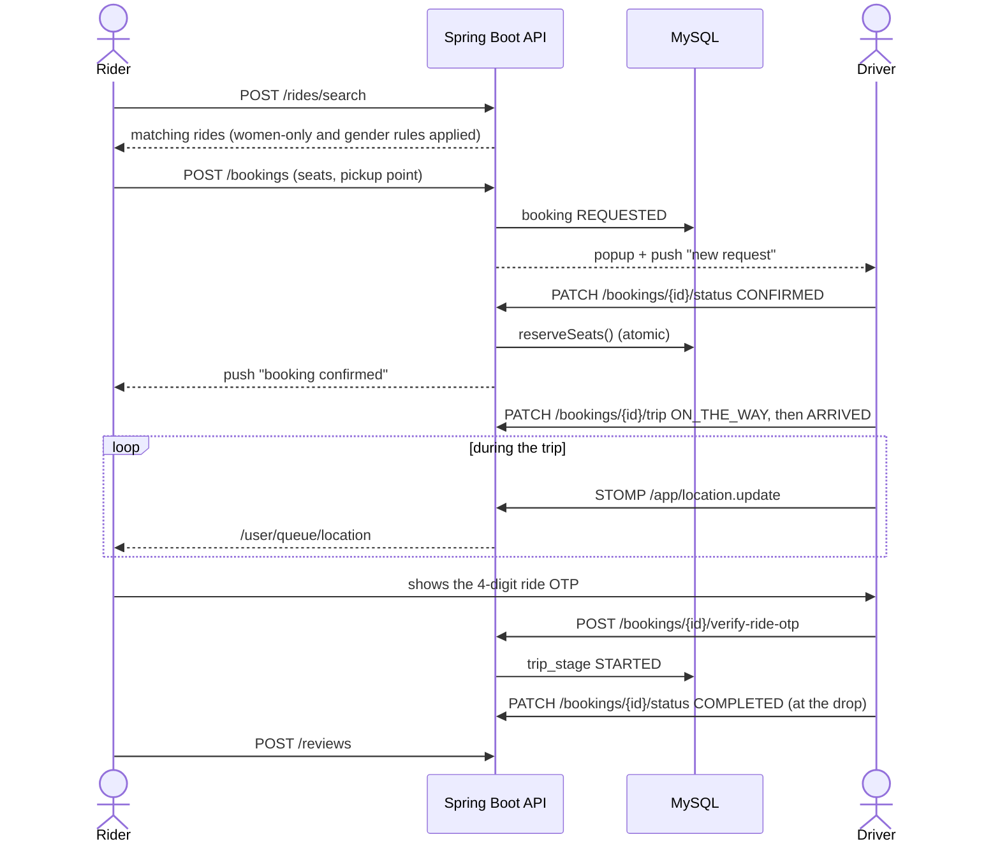
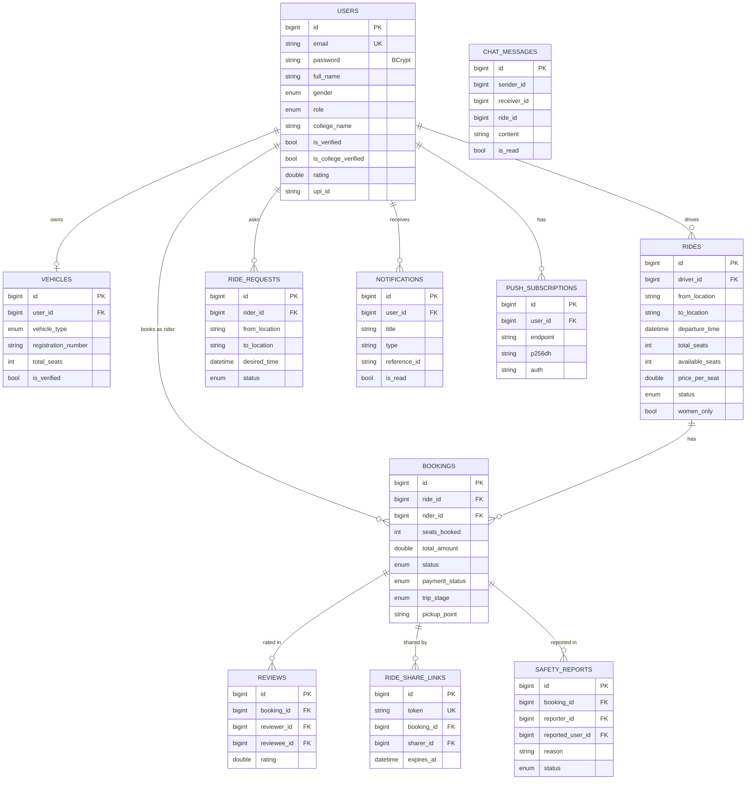
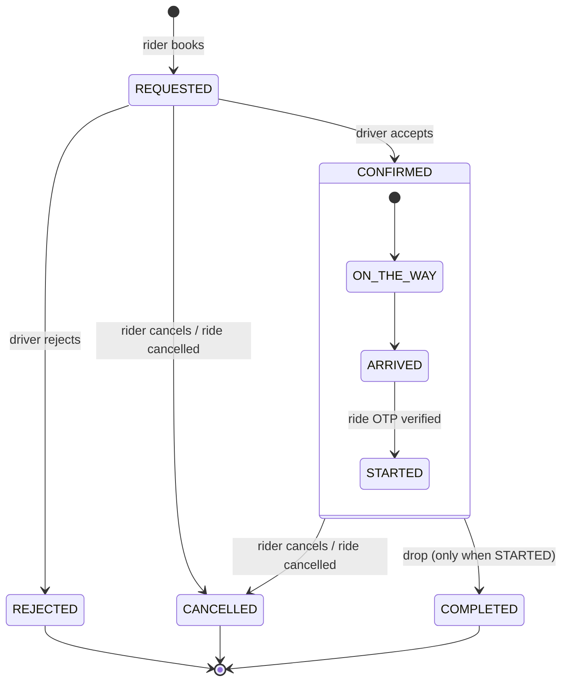
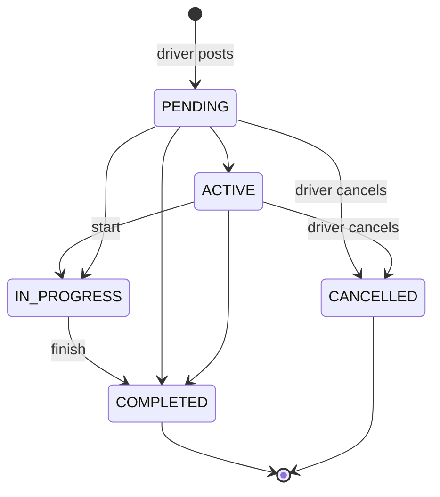

# AVIRO: High-Level and Low-Level Design

How AVIRO is built: the system as a whole (HLD, sections 1 to 4) and the classes, tables, APIs and states inside it (LLD, sections 5 to 8). Diagrams are Mermaid, so GitHub draws them.

## 1. Overview

AVIRO is a carpooling app for verified college students in Pune. Students who drive post rides and fellow students book seats. The fuel cost is split per seat, and every trip is tracked live with an OTP start and an SOS button.

**Goals**

- Only verified students can ride: email OTP, college ID check, and admin vehicle approval.
- Cheap shared travel: the driver sets a price per seat, and the app suggests a fair cost split.
- Safety on every trip: a ride OTP, live location, a share-trip link, SOS to emergency contacts, and reports.

**Users**

| Role | What they do |
| --- | --- |
| Rider | Searches rides, books seats, tracks the trip, chats, rates the driver |
| Driver | Adds a vehicle, posts rides, accepts or rejects bookings, starts the trip with the rider's OTP |
| Both | One account can ride and drive (the default for students) |
| Admin | Verifies college IDs and vehicles, sees stats, resolves safety reports |

**Scope**

In scope: web app (mobile-first PWA), REST API, live tracking over WebSocket, web push, email. Out of scope for now: online payment gateway, native apps, platform fee.

## 2. Architecture (HLD)

AVIRO is a three-tier web app: a React PWA, one stateless Spring Boot API, and two data stores. Live features (tracking, chat, popups) use STOMP over WebSocket on the same API.



The browser talks only to the API and to free map services. The API alone reaches MySQL, Redis, Brevo and the push services.

| Part | Technology | Hosted on | Job |
| --- | --- | --- | --- |
| Frontend | React 18, Tailwind, Leaflet, SockJS + STOMP, service worker | Vercel | Screens, maps, live trip view, push prompt |
| Backend | Spring Boot 3.2, Java 17, Spring Security, JPA | Render | REST API, WebSocket broker, business rules |
| Database | MySQL 8 | Aiven | All long-lived data |
| Cache | Redis | Upstash | OTPs, rate-limit counters, logout blacklist |
| Email | Brevo API | Brevo | OTP, SOS, share-link and report mails |
| Push | Web Push with VAPID keys | Browser push services | Alerts when the app is closed |
| Maps | CARTO tiles, OSRM, Nominatim | Public services | Map, road route, place search |
| Monitoring | Sentry, Vercel Analytics, GitHub Actions | Cloud | Errors, visits, tests on every PR |

## 3. Key flows (HLD)

Every flow passes through the JWT filter and the rate limiter first. Booking and trip steps also send a notification: saved in MySQL, pushed over WebSocket and Web Push.

**Sign up and verification**

1. The student registers with name, email, password and gender (`POST /auth/register`).
2. The backend saves the user unverified, stores a 6-digit OTP in Redis for 10 minutes, and emails it via Brevo.
3. The student enters the OTP (`/auth/verify-otp`) and receives an access token (24 h) and a refresh token (7 days).
4. College check: a `.edu.in` email OTP (`/auth/send-college-email-otp`), or a college ID photo upload that an admin approves.
5. A driver adds a vehicle with plate and licence photos. Admin approval is needed when `AVIRO_REQUIRE_VEHICLE_VERIFICATION=true`.

**Post a ride**

1. The driver picks from and to on the map, the time, seats and the price per seat (`POST /rides`).
2. Checks: college verified, a supported vehicle (Bike, Scooty or Car), seats within the vehicle limit (1 on two wheelers, up to 4 in a car), departure at most 30 days ahead, no duplicate route at the same time.
3. The ride is saved as PENDING. Open ride requests on the same route get a match notification.

**Search, book and trip**



Payment: the rider chooses cash or UPI; the driver confirms cash with `/bookings/{id}/confirm-cash`.

**Safety**

- Share trip: `/safety/share-ride/{bookingId}` makes a token link; anyone can open `/share/{token}` without logging in until it expires.
- SOS: `/safety/sos` emails the emergency contacts with the live location and alerts the people on the ride over `/topic/sos/{rideId}`.
- Report: `/safety/report/{bookingId}` saves a safety report that an admin resolves.

**Chat**

Chat opens only between a rider and driver with a CONFIRMED booking on a ride that is not over. Messages go over STOMP (`/app/chat.send` to `/user/queue/messages`) and are stored in `chat_messages`. When the ride ends, the chat disappears from the list (`GET /chat/active`).

## 4. Non-functional design (HLD)

**Security**

| Concern | How AVIRO handles it |
| --- | --- |
| Login | BCrypt passwords; JWT access token 24 h, refresh token 7 days |
| Logout | The token goes on a Redis blacklist until it expires |
| Brute force | Fixed-window rate limits in Redis: login 10/min, register 5 per 10 min, OTP resend 3 per 10 min, ride OTP 5 per 10 min |
| Row-level access | Every booking, chat and trip call checks that the caller is the rider, the driver or an admin |
| WebSocket | A JWT on CONNECT; `/topic/track/{rideId}` and `/topic/sos/{rideId}` only for people on that ride |
| XSS | Place, note and pickup fields reject `<` and `>`; map popups escape text |
| Uploads | File type checked by its signature bytes, not the name; photos served only to the owner and admins |
| CORS | Only localhost, `aviro-*.vercel.app` and the `AVIRO_ALLOWED_ORIGINS` list |
| Privacy | Account delete removes personal data; a share link shows only the trip, not the phone number |

**Scale and performance**

- Stateless API: any number of backend copies can run behind a load balancer; shared state lives in MySQL and Redis.
- Indexed queries on rides (status, departure time), bookings (ride, rider) and chat (ride, sender, receiver).
- Live locations are kept in memory (`LiveLocationStore`), not written to MySQL on every GPS ping.
- Push and email are sent in a background thread pool (`AsyncConfig`), so a slow mail server never slows an API call.

**Reliability**

- If Redis is down, the rate limiter lets requests through instead of locking everyone out.
- Notifications are saved first, then pushed; the app reloads missed ones when it opens.
- `KeepAliveService` pings `/health` so the free Render instance does not sleep.
- Sentry catches frontend errors; GitHub Actions runs backend and frontend tests on every pull request.

## 5. Backend classes (LLD)

The backend follows the usual Spring layers: controller → service (interface + `impl`) → repository → entity. DTOs keep entities out of the API, and `GlobalExceptionHandler` turns an `AviroException` into a clean `{success, message}` reply.

| Package (`com.aviro.`) | Main classes | Job |
| --- | --- | --- |
| `config` | SecurityConfig, WebSocketConfig, WebSocketAuthInterceptor, RedisConfig, AsyncConfig, AdminBootstrap | Filter chain and CORS, STOMP broker on `/ws`, WebSocket auth, Redis templates, async pool, first admin account |
| `security` | JwtTokenProvider, JwtAuthFilter, RateLimitFilter, TokenBlacklistService, AuthUserCache | Make and check tokens, per-IP and per-user limits, logout blacklist, short-lived user cache |
| `controller` | Auth, User, Ride, Booking, RideRequest, Chat, Location, LiveTracking, Safety, PublicShare, Review, Notification, Push, Admin, Health | REST endpoints and STOMP `@MessageMapping` handlers |
| `service` | AuthService, RideService, BookingService, ChatService, ReviewService, RideRequestService, UserService, NotificationService | Business rules (status moves, seat counts, access checks) |
| `service` (helpers) | OtpService, EmailService, WebPushService, CollegeIdVerificationService, LiveLocationStore, AccountDeletionService, KeepAliveService | OTPs in Redis, Brevo email, VAPID push, college ID rules, in-memory GPS, delete account, keep Render awake |
| `repository` | One Spring Data JPA repository per entity | Queries, including search by route and time |
| `entity` | User, Vehicle, Ride, Booking, RideRequest, ChatMessage, Notification, PushSubscription, Review, RideShareLink, SafetyReport | Tables (section 6) |
| `enums` | Role, Gender, VehicleType, RideStatus, BookingStatus, TripStage, PaymentStatus, RideRequestStatus, SafetyReportStatus | Fixed values stored as text |

**Key rules in code**

- `VehicleType.supported()` allows only BIKE, SCOOTY and CAR for new rides; `maxRiders()` gives 1 for two wheelers and 4 for a car.
- `RideServiceImpl.ALLOWED_MOVES` holds the ride status changes a driver may make (section 8).
- `RideRepository.reserveSeats()` is one atomic SQL update (`availableSeats - n WHERE availableSeats >= n`), so two riders can never take the last seat; `releaseSeats()` gives seats back on cancel or reject.
- `NotificationService.send()` saves the row, sends it on `/user/queue/notifications`, then sends a Web Push.
- Config switches: `aviro.vehicle.require-verification`, `aviro.frontend-url`, `aviro.ride.*` limits, JWT expiry times.

## 6. Data model (LLD)

MySQL holds 11 tables made by JPA (`ddl-auto: update`). Every table also has `created_at` and `updated_at` from `BaseEntity`.



`bookings` is the centre of a trip: seat count, amount, payment, pickup point and trip stage all live there. Reviews, share links and safety reports each point to one booking. Chat rows store plain user and ride ids (no foreign keys); access is checked in the chat service against the booking.

**Indexes**

| Table | Index columns | Used by |
| --- | --- | --- |
| rides | status, departure_time · driver_id, departure_time | Search, My Rides |
| bookings | rider_id, created_at · ride_id, status | My Bookings, driver's request list |
| chat_messages | ride_id, sender_id, receiver_id · receiver_id, is_read | Conversation, unread badge |
| notifications | user_id, created_at · user_id, is_read | Bell list, unread count |
| ride_requests | status, desired_time · rider_id | Open demand, my alerts |
| ride_share_links | token (unique) · booking_id, sharer_id | Public share page |
| safety_reports | status, created_at · booking_id, reporter_id | Admin queue, reports on a trip |

## 7. API contracts (LLD)

All REST paths start with `/api`. Every reply has the shape `{ "success": true|false, "message": "...", "data": ... }`. Calls need `Authorization: Bearer <access token>`, except `/auth/*`, `/public/share/*`, `/push/public-key` and `/health`.

**REST endpoints**

| Base | Endpoints |
| --- | --- |
| `/auth` | POST `register`, `login`, `login-verify-otp`, `verify-otp`, `resend-otp`, `refresh-token`, `forgot-password`, `reset-password`, `logout`, `send-college-email-otp`, `verify-college-email-otp` |
| `/users` | GET/PUT `profile`; GET/POST `vehicle`; POST `vehicle/photo/{kind}`, `upload-college-id`; POST/DELETE `ride-buddies/{id}`; GET `dashboard`; DELETE `me` |
| `/rides` | POST (create), POST `search`, GET `{id}`, GET `my`, GET `nearby`, PATCH `{id}/status`, DELETE `{id}`, GET `fare-estimate` |
| `/bookings` | POST (book), GET `my`, GET `{id}`, PATCH `{id}/status`, PATCH `{id}/payment`, POST `{id}/confirm-cash`, DELETE `{id}`, GET `ride/{rideId}`, GET `{id}/ride-otp`, POST `{id}/verify-ride-otp`, PATCH `{id}/trip` |
| `/ride-requests` | POST, GET `my`, GET `open`, DELETE `{id}` |
| `/chat` | POST `send`, GET `{rideId}/{otherUserId}`, GET `active`, GET `unread/{s}/{r}`, POST `mark-read/{s}/{r}` |
| `/safety` | GET/POST `emergency-contacts`, GET `trips`, POST `sos`, POST `share-ride/{bookingId}`, GET `report-reasons`, POST `report/{bookingId}` |
| `/public/share` | GET `{token}` (no login) |
| `/reviews` | POST, GET `user/{userId}` |
| `/notifications` | GET `my`, GET `unread-count`, DELETE (all), DELETE `{id}` |
| `/push` | GET `public-key`, POST/DELETE `subscribe` |
| `/admin` | GET `pending-verifications`, `pending-vehicles`, `stats`, `safety-reports`; POST `verify-college-id/{id}`, `reject-college-id/{id}`, `verify-vehicle/{id}`, `reject-vehicle/{id}`, `safety-reports/{id}/resolve` |

**Example: book a seat**

```json
POST /api/bookings
{ "rideId": 42, "seatsBooked": 1, "pickupPoint": "Kothrud Depot", "pickupLat": 18.5074, "pickupLng": 73.8077 }

200 OK
{ "success": true, "message": "Booking request sent!", "data": { "id": 311, "status": "REQUESTED", "totalAmount": 45.0 } }
```

**WebSocket (STOMP over SockJS at `/ws`)**

The client sends its JWT in the CONNECT frame. It sends to `/app/...` and listens on its own `/user/queue/...` or on a ride topic.

| Client sends to | Server delivers on | Use |
| --- | --- | --- |
| `/app/location.update` | `/user/queue/location` (rider) | Driver GPS during a trip |
| `/app/location.rider` | `/user/queue/rider-location` (driver) | Rider's position at pickup |
| `/app/location.message` | `/user/queue/quick-message` | Quick texts such as "I'm here" (confirmed bookings only) |
| `/app/chat.send` | `/user/queue/messages` | Chat |
| `/app/track.update` | `/topic/track/{rideId}` | Ride-wide tracking (ride members only) |
| `/app/sos.alert` | `/topic/sos/{rideId}` | SOS to everyone on the ride |
| (server) | `/user/queue/notifications` | Live notifications |

## 8. States, frontend and tests (LLD)

**Booking status**



**Ride status**



Any other status change is refused with HTTP 400. Cancelling a ride cancels its open bookings and frees the seats. A booking can be marked COMPLETED at the drop only when its trip_stage is STARTED; that opens reviews and closes the chat.

**Frontend structure** (`frontend/src`)

| Folder | Contents |
| --- | --- |
| `pages/` | Landing, Login, Register, VerifyOtp, Dashboard, SearchRide, OfferRide, RideDetail, Bookings, MyRides, LiveTracking, Chat, Safety, Profile, Settings, Admin, SharedTrip, Legal, NotFound |
| `components/common/` | AppLayout, Sidebar, NotificationBell, LiveMap, LocationInput, TripAlerts, RideAlerts, RideOTPCard, PaymentChoiceModal, ReviewModal, CollegeIdUpload, VehicleDocs, Icon |
| `services/` | `api.js` (Axios with token refresh), `websocket.js` (STOMP client), `push.js` (service worker subscribe), `monitoring.js` (Sentry) |
| `hooks/` | `useBookRide`, `useOpenChats` |
| `utils/` | `mapStyle.js` (tiles, route line, pins, HTML escape), `split.js` (cost split), `when.js` (dates), `geo.js`, `colleges.js`, `puneLocations.js` |
| `store/` | Redux store: auth, booking, chat, ride and UI slices; token and user saved in localStorage |

Routes are guarded: logged-out users see only Landing, Login, Register, Legal and the public share page; `/admin` needs the ADMIN role.

**Testing**

| Level | Tool | What it covers |
| --- | --- | --- |
| Backend unit | JUnit 5, Mockito | Vehicle type rules, image signature check, TTL cache, live location store |
| Backend API | Spring Boot Test + MockMvc on H2 (MySQL mode), Redis and email mocked | Register and login, ride rules, booking and seat rules, chat access, ride OTP, safety, XSS and upload checks |
| Frontend unit | Jest + React Testing Library | Icon, trip status logic, cost split, date labels |
| CI | GitHub Actions `tests.yml` | `mvn test`, `npm test`, `npm run build` on every PR and push to main |
